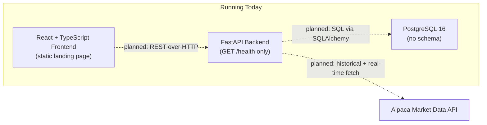

# Architecture Overview

MarketPulse is a layered monolith, not a microservices system — see
[ADR 001](decisions/001-layered-monolith.md) for the reasoning.

## Current State vs. Planned Integration

The diagram below shows what currently runs locally versus what is
planned. Solid boxes describe the real, verified state of each
component today; dashed arrows are **planned** connections that do
not exist in code yet. The frontend does not call the backend, and
the backend does not query PostgreSQL — both run independently today.

## Currently Implemented Components

- **FastAPI application** (`backend/app/main.py`): a single app
  instance exposing `GET /health`. No routing layers, business logic,
  or data access code exist yet — there is nothing to layer.
- **React frontend** (`frontend/src/`): a static landing page built
  from a reusable `FeatureCard` component. It makes no network calls.
- **PostgreSQL** (`docker-compose.yml`): a local Postgres 16 container
  with a named volume for persistence. No schema or tables exist.
- **CI** (`.github/workflows/ci.yml`): runs backend and frontend
  checks independently and in parallel. Does not run against a live
  database, because no code touches one yet.

## Planned Backend Layers

As real functionality is added, backend code will be organized into
layers — created when the first feature needs them, not in advance:

- **`routes/`** — HTTP request/response handling only: parsing input,
  returning status codes, no business logic.
- **`services/`** — business logic (e.g., "get historical prices,
  fetching from the provider if not already stored").
- **`repositories/`** — database access via SQLAlchemy; no business
  logic, no HTTP concerns.
- **`providers/`** — external API integration (Alpaca), isolated
  behind an interface so it can be mocked in tests.

## Planned Ingestion Flow

Once the data model is settled (see the open questions below), a
historical price request is expected to flow as:

1. Frontend calls a REST endpoint on the FastAPI backend.
2. The route delegates to a service, which checks the repository
   layer for existing data in PostgreSQL.
3. For missing data, the service calls the Alpaca provider client,
   normalizes the response, and persists it via the repository.
4. The response is returned to the frontend as validated JSON.

The record identity model (how a price bar is uniquely identified),
handling of adjusted vs. unadjusted prices, duplicate and correction
handling, and partial-ingestion failure handling are **open design
questions**, deliberately deferred to Milestone 2 and resolved before
any database model is written.

## Testing Strategy

- **Backend:** pytest, using FastAPI's `TestClient` for route-level
  tests. Currently limited to the `/health` check, since there is no
  business logic yet. Integration tests against a live Postgres
  instance will be added once repository code exists — intentionally
  not added to CI before then.
- **Frontend:** Vitest + React Testing Library, testing component
  output against props rather than implementation details.
- **CI:** backend and frontend are verified independently and in
  parallel on every push and pull request targeting `main`.

## Architectural Boundaries and Tradeoffs

MarketPulse is built as a single deployable backend application,
internally separated by layer, rather than separate services per
domain (ingestion, API, analytics). This trades independent
scalability and deployment of individual components for
significantly simpler local development, testing, and reasoning at
the current scale. See [ADR 001](decisions/001-layered-monolith.md)
for the conditions under which this would be revisited.
